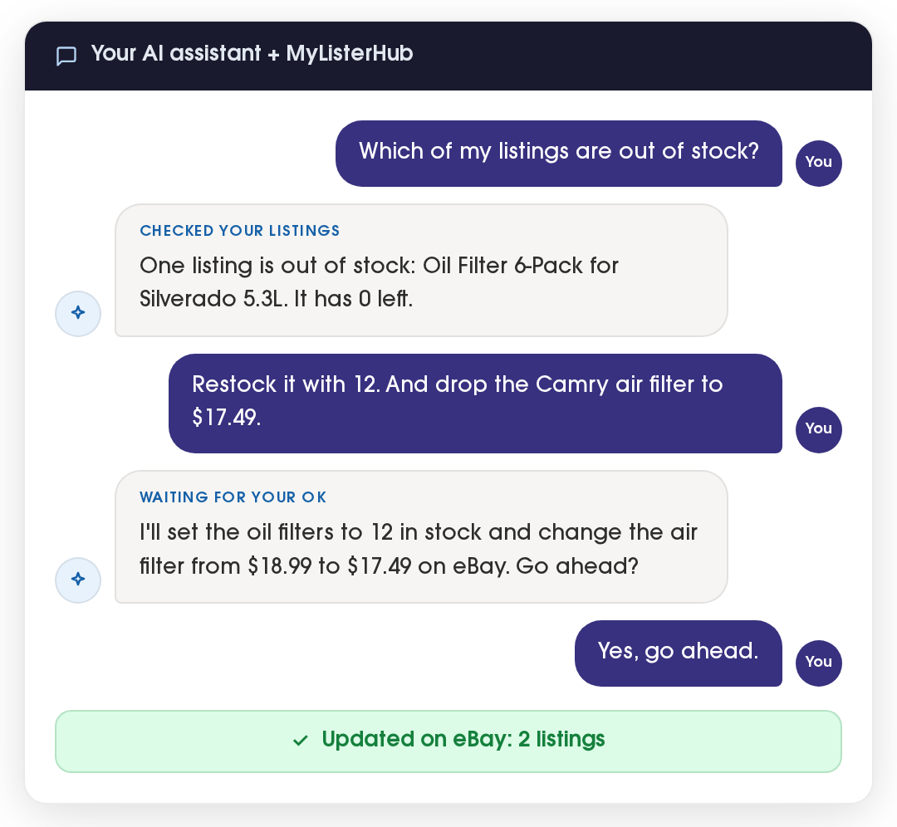
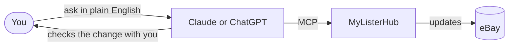

<div align="center">


# MyListerHub for Claude and ChatGPT

**Run your eBay store just by asking.**

Check stock, change prices, answer buyers and list new items from Claude or ChatGPT.

[](https://github.com/FmTod/mylisterhub-ai-plugin/actions/workflows/ci.yml)
[](https://github.com/FmTod/mylisterhub-ai-plugin/releases/latest)


[Setup guide](https://www.mylisterhub.com/connect-ai-assistants) · [Support](https://www.mylisterhub.com/support) · [Privacy](https://www.mylisterhub.com/privacy-policy) · [Terms](https://www.mylisterhub.com/terms-of-service)



</div>

## What you can do

| | Skill | Try asking |
| --- | --- | --- |
| 👋 | **`get-started`**<br>First-run tour: checks the connection and shows a store snapshot | *"What can MyListerHub do?"* |
| ☀️ | **`daily-store-check`**<br>Orders to ship, buyers waiting, sold-out listings and the last 7 days of sales | *"What needs my attention today?"* |
| 🏷️ | **`list-an-item`**<br>From a description and photo links to a live eBay listing | *"List these brake pads. They ship from Austin, TX 78701."* |
| 💬 | **`answer-buyers`**<br>Drafts a reply to each unanswered buyer message and sends it once you approve | *"Catch me up on buyer messages."* |

Beyond the skills, you can ask for anything the MyListerHub tools cover: search listings by title or SKU, change prices and quantities, look up open orders and tracking, and edit your order forms and description templates.

## How it works



- **You sign in with your MyListerHub account** in a window that opens from Claude or ChatGPT. There are no API keys to copy.
- **The assistant sees only what your MyListerHub user can.** Team members each connect their own login.
- **Changes go live on eBay right away.** Prices, quantities, listings and buyer replies take effect immediately, so the assistant is set up to show you the exact change and wait for your OK.
- **Disconnect anytime** from your Claude or ChatGPT connector settings.

You need a MyListerHub account with an active subscription and a connected eBay account.

## Install

<details open>
<summary><b>Claude Code</b></summary>

```bash
claude plugin marketplace add FmTod/mylisterhub-ai-plugin
claude plugin install mylisterhub@mylisterhub
```

Then run `/mcp`, pick the MyListerHub server and choose **Authenticate**.

</details>

<details>
<summary><b>Claude on the web or desktop</b></summary>

1. Download [`claude.zip`](https://github.com/FmTod/mylisterhub-ai-plugin/releases/latest/download/claude.zip) from the latest release.
2. Upload it under **Customize → Plugins → Add → Upload plugin**.
3. Connect MyListerHub from the plugin's **Connectors** tab.

To add only the connector, without the skills, follow the [setup guide](https://www.mylisterhub.com/connect-ai-assistants).

</details>

<details>
<summary><b>ChatGPT</b></summary>

Install MyListerHub from the ChatGPT plugin directory once it's listed. Until then, follow the [setup guide](https://www.mylisterhub.com/connect-ai-assistants).

</details>

## Development

### Layout

One repo serves both vendors. The skills and icons are shared; each vendor reads its own manifest and MCP file.

| Path | Read by |
| --- | --- |
| `plugin.json`, `mcp.json` | ChatGPT and other [Agent Plugins](https://agent-plugins.org) clients. `plugin.json` also holds the ChatGPT listing, review test cases and release notes under `extensions.com.openai` |
| `.claude-plugin/plugin.json`, `.mcp.json` | Claude |
| `.claude-plugin/marketplace.json` | Claude Code's `plugin marketplace add` |
| `skills/<name>/SKILL.md` | Both |
| `assets/` | Directory icons |

Keep `name` and `version` the same in both manifests, and the server URL the same in both MCP files. Skill frontmatter may only use `name`, `description` (up to 200 characters), `license`, `compatibility`, `metadata` and `allowed-tools`; claude.ai rejects any other key.

### Build

```bash
python3 scripts/build.py
```

It checks the rules above, then writes `dist/chatgpt.zip` and `dist/claude.zip`.

### CI

Every push and pull request runs [`ci.yml`](.github/workflows/ci.yml):

- **Schemas:** `plugin.json` and `mcp.json` against the Agent Plugins schemas.
- **Claude:** `claude plugin validate`.
- **Build:** `scripts/build.py`, with both ZIPs uploaded as workflow artifacts.

### Releasing

Releases are cut by [release-please](https://github.com/googleapis/release-please) from [Conventional Commits](https://www.conventionalcommits.org): `feat:` bumps the minor version, `fix:` the patch.

1. Merge to `main`. release-please opens or updates a release PR that bumps `version` in both manifests and the changelog.
2. Merge the release PR. It tags the release, and the workflow attaches `chatgpt.zip` and `claude.zip`.
3. Upload `chatgpt.zip` at **platform.openai.com/plugins → Upload plugin to make changes**.

Changes to the MCP server's tools reach ChatGPT through OpenAI's daily rescan and need no new ZIP. The review test cases in `plugin.json` run against the reviewer account that the MyListerHub app's `mcp:create-review-tenant` command creates; when a tool is renamed or that sample data changes, update them to match.
